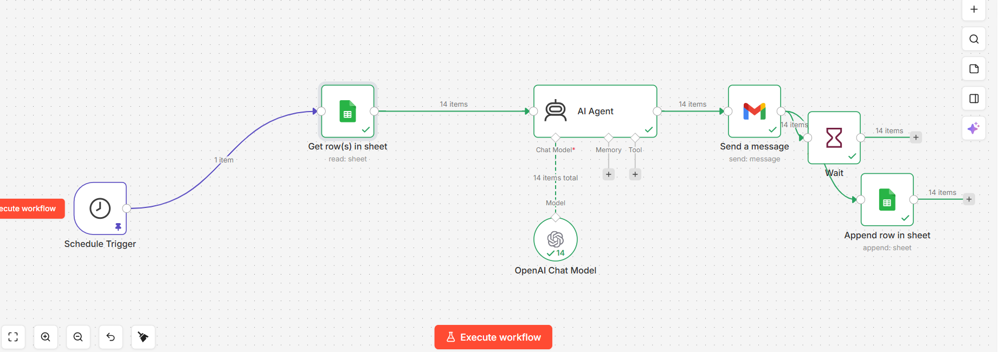
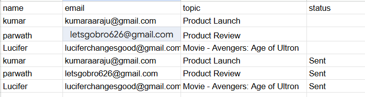
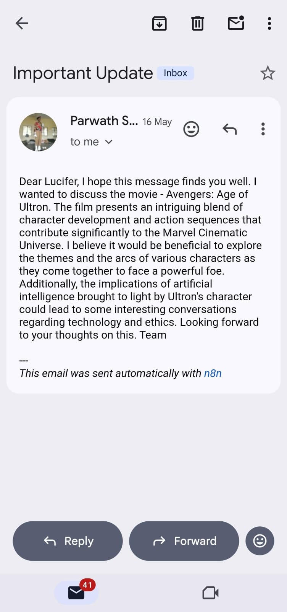

# AI Personalized Email Outreach Automation

An AI-powered email outreach workflow built using **n8n**, **OpenAI GPT-4o Mini**, **Google Sheets**, and **Gmail**. The workflow automatically generates personalized emails for recipients listed in a Google Sheet, sends them through Gmail, and logs the processing status back into the sheet.

<p align="center">
  
</p>

---

## 📌 Overview

This workflow demonstrates how AI can automate personalized email communication without manual intervention.

At every scheduled execution, the workflow:

- Reads recipient details from Google Sheets
- Uses OpenAI GPT-4o Mini to generate a personalized email based on each recipient's topic
- Sends the generated email via Gmail
- Waits before processing the next email (to avoid rapid dispatch)
- Updates Google Sheets with the delivery status

---

## ✨ Features

- ⏰ Scheduled workflow execution
- 📄 Google Sheets integration
- 🤖 AI-generated personalized email content
- 📧 Gmail automation
- ⏳ Configurable wait node
- 📊 Automatic status logging
- 🔄 Fully automated end-to-end pipeline

---

## 🏗 Workflow Architecture

```text
                 Schedule Trigger
                        │
                        ▼
             Read Google Sheet Rows
                        │
                        ▼
               OpenAI GPT-4o Mini
         (Generate Personalized Email)
                        │
                        ▼
                  Gmail Send Node
                        │
                        ▼
                    Wait Node
                        │
                        ▼
           Append Status to Google Sheet
```

---

## 🖼 Workflow Screenshots

### Workflow


### Execution — Google Sheet status



### Execution — Sample delivered email



---

## 🛠 Tech Stack

- n8n
- OpenAI GPT-4o Mini
- Google Sheets API
- Gmail API

---

## 📂 Repository Structure

```text
ai-personalized-email-outreach-automation
│
├── README.md
├── LICENSE
├── .gitignore
├── workflow.json
│
├── screenshots/
│   ├── workflow.png
│   ├── execution-sheet.png
│   └── execution-email.jpeg
│
├── docs/
│   └── setup.md
│
└── sample-data/
    └── sample_contact.csv
```

---

## 📄 Expected Input

The workflow expects a Google Sheet with the following columns.

| name | email | topic |
|------|-------|-------|
| John Doe | john.doe@example.com | Artificial Intelligence |
| Alice Smith | alice.smith@example.com | Cloud Computing |
| Michael Brown | michael.brown@example.com | Cyber Security |

A `status` column is added automatically by the workflow once an email has been sent.

A sample dataset is provided in:

```text
sample-data/sample_contact.csv
```

---

## 🚀 Setup

1. Clone this repository.

```bash
git clone https://github.com/YOUR_USERNAME/ai-personalized-email-outreach-automation.git
```

2. Open n8n.

3. Import `workflow.json`.

4. Configure the following credentials in n8n and attach them to the corresponding nodes:

- OpenAI API credential → **OpenAI Chat Model** node
- Gmail OAuth2 credential → **Send a message** node
- Google Sheets OAuth2 credential → **Get row(s) in sheet** and **Append row in sheet** nodes

5. Replace `YOUR_GOOGLE_SHEET_ID` (in both Google Sheets nodes) with your own Google Sheet's document ID.

6. Execute the workflow.

See [`docs/setup.md`](docs/setup.md) for a more detailed walkthrough.

---

## ⚠️ Known Limitations

- The Gmail subject line is currently hardcoded to `"Important Update"` regardless of the recipient's topic. Consider making this dynamic (e.g. `={{ $json.topic }}`) for a more personalized touch.
- There's no retry logic if the Gmail send or Sheets append step fails mid-run.
- The `Wait` node uses n8n's default duration — tune it to match your own sending-rate needs.

---

## 💡 Use Cases

- Personalized email campaigns
- Marketing outreach
- Educational notifications
- Internal organizational communication
- AI-assisted customer engagement

---

## 🔮 Future Improvements

- Retry mechanism for failed emails
- Dynamic subject lines and email templates
- Attachment support
- CRM integration
- Analytics dashboard
- Multi-language email generation

---

## 👨‍💻 Author

**Parwath Sri Raju K**

- GitHub: https://github.com/Parwath116
- LinkedIn: https://linkedin.com/in/parwath-sri-raju-k

---

## 📜 License

This project is licensed under the MIT License.
